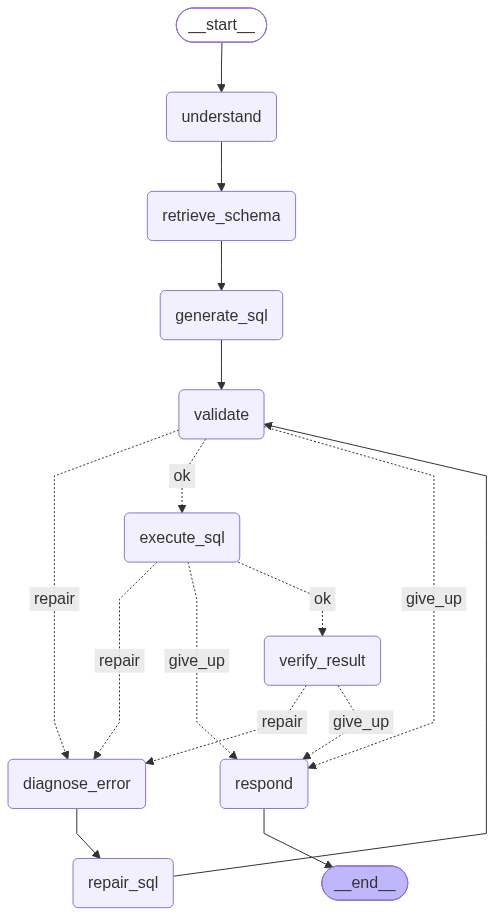
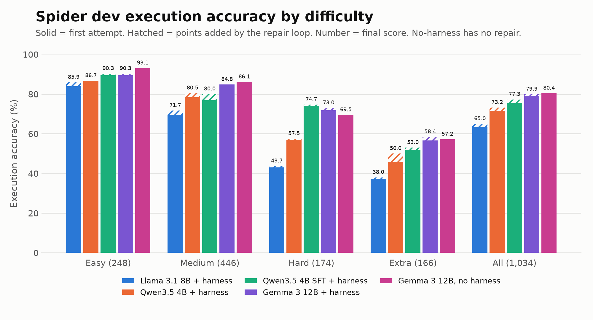
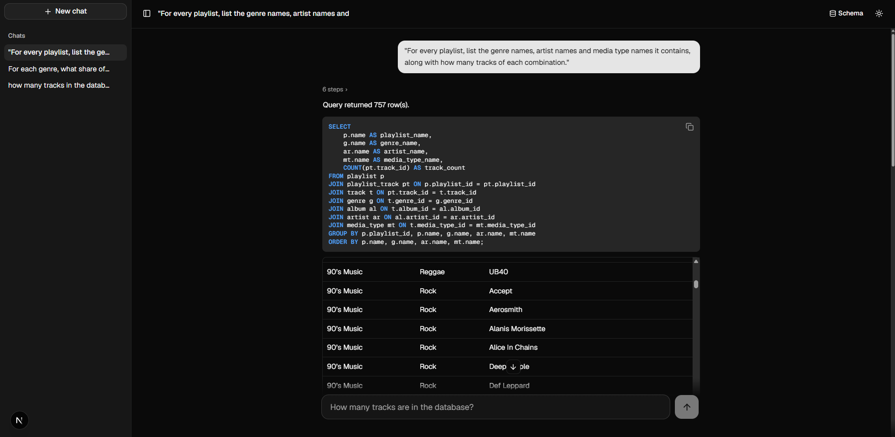
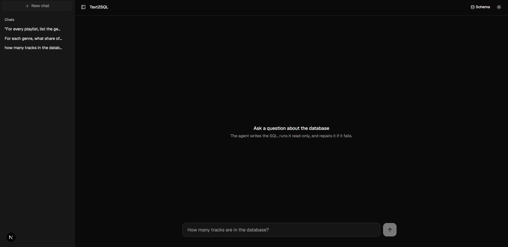

# Self-Healing Text-to-SQL Assistant

## Description

Ask a question in plain English and get back the SQL and the rows it returns. If the generated SQL fails validation or errors out in Postgres, the assistant reads the error, repairs the query, and tries again, up to three times.

It runs on any OpenAI-compatible model, including my own: Qwen3.5-4B fine-tuned on Spider, which scores 77.3% on the Spider dev set inside this harness, against 73.2% for the base model.

I built this to learn the stack behind LLM agents by building one. Most text-to-SQL demos stop at "LLM writes a query". The harder part is what happens when that query is wrong: a table name that doesn't exist, a column on the wrong table, or a statement that should never run. This project handles those cases in code rather than hoping the prompt covers them.

## Table of Contents

- [How It Works](#how-it-works)
- [Features](#features)
- [Installation](#installation)
- [Usage](#usage)
- [Benchmark](#benchmark)
- [Fine-Tuned Model](#fine-tuned-model)
- [Project Layout](#project-layout)
- [UI Demo](#ui-demo)
- [Credits](#credits)
- [License](#license)

## How It Works

The agent is a LangGraph state machine. Each node reads and updates a shared typed state (`backend/graph/state.py`).



1. **understand** and **retrieve_schema** load the question and the live database schema.
2. **generate_sql** asks the LLM for a query, using structured output (`sql`, `tables_used`, `reasoning`).
3. **validate** parses the SQL with sqlglot and rejects anything that isn't a single `SELECT` or `WITH ... SELECT`, plus unknown tables and columns.
4. **execute_sql** runs the query as a read-only Postgres role, with a 5s statement timeout and a 1000-row cap.
5. If validation or execution fails, **diagnose_error** classifies the error and **repair_sql** asks the LLM to fix it, then the query goes back through validation.
6. **verify_result** checks a successful run: an empty or all-NULL result is sent back for one more try.
7. **respond** returns the result, or gives up after 3 repair attempts.

## Features

- Ask questions in plain English about the [Chinook](https://github.com/lerocha/chinook-database) sample database
- Schema enrichment: the LLM sees primary keys, join paths, and (optionally) sample values, not just table names
- A validation step after SQL generation: only `SELECT` queries pass, and unknown tables or columns get a "did you mean" hint
- Read-only database access with a timeout and a row limit
- Failed or empty queries are fixed and retried, up to 3 times
- A [fine-tuned Qwen3.5-4B model](https://huggingface.co/mehul79/Text2SQL-4B-Model) that scores 77.3% on Spider, up from 73.2%
- Works with any OpenAI-compatible LLM provider
- A chat UI with saved chats, follow-up questions, and live progress

## Installation

Requirements: Python 3.14, [uv](https://docs.astral.sh/uv/), Docker, Node.js.

1. Clone the repo and install Python dependencies:

   ```bash
   git clone https://github.com/mehul79/Self-healing-Text2SQL-Agent.git
   cd Self-healing-Text2SQL-Agent
   uv sync
   ```

2. Copy `.env.example` to `.env` and fill in the Postgres credentials, the read-only user (`READONLY_DB_*`), the chat store user (`APP_DB_*`), and your LLM provider's `BASE_URL`, `LLM_API_KEY`, and `MODEL_NAME`. Set `SCHEMA_SAMPLE_VALUES=1` to send a few real values per column to the LLM.

3. Start Postgres:

   ```bash
   docker compose up -d
   ```

4. Load the Chinook schema and data. Download `Chinook_PostgreSql.sql` from the [Chinook repo](https://github.com/lerocha/chinook-database) into a `seed/` folder at the repo root (it's gitignored), then load it as the owner user:

   ```bash
   docker compose exec -T postgres psql -U <POSTGRES_USER> -d <POSTGRES_DB> < seed/Chinook_PostgreSql.sql
   ```

5. Create the read-only role the app connects as, using the name and password from `READONLY_DB_USER` and `READONLY_DB_PASSWORD`:

   ```sql
   CREATE ROLE readonly_user WITH LOGIN PASSWORD '<your_readonly_password>';
   GRANT CONNECT ON DATABASE <POSTGRES_DB> TO readonly_user;
   GRANT USAGE ON SCHEMA public TO readonly_user;
   GRANT SELECT ON ALL TABLES IN SCHEMA public TO readonly_user;
   ALTER DEFAULT PRIVILEGES IN SCHEMA public GRANT SELECT ON TABLES TO readonly_user;
   ```

6. Create the chat store: a separate database, owned by a role that can write there and can't connect to Chinook. Use the names from `APP_DB_USER` and `APP_DB_NAME`. Run these one at a time in `psql` as the owner user (`CREATE DATABASE` can't run inside a transaction):

   ```sql
   CREATE ROLE app_writer WITH LOGIN PASSWORD '<your_app_writer_password>';
   CREATE DATABASE text2sql_app OWNER app_writer;
   REVOKE CONNECT ON DATABASE text2sql_app FROM PUBLIC;
   REVOKE CONNECT ON DATABASE <POSTGRES_DB> FROM PUBLIC;
   GRANT CONNECT ON DATABASE <POSTGRES_DB> TO readonly_user;
   ```

   The API creates the chat tables on startup.

7. Install frontend dependencies:

   ```bash
   cd frontend
   npm install
   ```

## Usage

Start the API from the repo root, so `backend` resolves as a package:

```bash
uv run uvicorn backend.api.main:app --reload
```

Interactive docs, with every endpoint, are at http://127.0.0.1:8000/docs.

Example:

```bash
curl -X POST http://127.0.0.1:8000/api/query \
  -H "Content-Type: application/json" \
  -d '{"question": "How many tracks are in the database?"}'
```

Start the frontend in a second terminal:

```bash
cd frontend
npm run dev
```

Then open http://localhost:3000.

## Benchmark

Execution accuracy on the [Spider](https://yale-lily.github.io/spider) dev set (1,034 questions, 20 SQLite databases), scored by Spider's official evaluator. Harness rows are final answers with the repair loop on (up to 3 repairs):

<picture>
  <source srcset="docs/benchmark-dark.png" media="(prefers-color-scheme: dark)">
  
</picture>

| Model | Setup | Easy (248) | Medium (446) | Hard (174) | Extra (166) | **All (1,034)** |
| --- | --- | --- | --- | --- | --- | --- |
| `meta-llama/llama-3.1-8b-instruct` | Harness | 85.9 | 71.7 | 43.7 | 38.0 | **65.0** |
| `Qwen/Qwen3.5-4B` (Qwen3.5-4B-Base) | No harness | 69.8 | 63.2 | 46.0 | 23.5 | **55.5** |
| `Qwen/Qwen3.5-4B` (Qwen3.5-4B-Base) | Harness | 86.7 | 80.5 | 57.5 | 50.0 | **73.2** |
| [`mehul79/Text2SQL-4B-Model`](https://huggingface.co/mehul79/Text2SQL-4B-Model) (Qwen3.5-4B-SFT) | Harness | 90.3 | 80.0 | 74.7 | 53.0 | **77.3** |
| `google/gemma-3-12b-it` | Harness | 90.3 | 84.8 | 73.0 | 58.4 | **79.9** |
| `google/gemma-3-12b-it` | No harness | 93.1 | 86.1 | 69.5 | 57.2 | **80.4** |

- **A 4B model gets close to a 12B one.** With fine-tuning and the harness, Qwen3.5-4B scores 77.3, just 2.6 points behind Gemma 3 12B, a model three times its size. On hard questions it does better (74.7 against 73.0).
- **The harness lifts the base model a lot**, from 55.5 to 73.2. Fine-tuning adds another 4.1, mostly on hard questions.
- **The repair loop helps a little** (+0.7 to +1.9). It fixes queries that fail, not ones that run and return wrong rows.

Full tables and run details: [docs/benchmark.md](docs/benchmark.md). Raw per-question results are in [`results/`](results/).

## Fine-Tuned Model

The LoRA adapter for Qwen3.5-4B, trained on Spider, is on Hugging Face: [mehul79/Text2SQL-4B-Model](https://huggingface.co/mehul79/Text2SQL-4B-Model). It scores 77.3% in the harness, against 73.2% for the base model.

- [docs/training.md](docs/training.md): how it was trained, a step-by-step guide to train your own, and hardware requirements.
- [`training/`](training/): the code. `build_traces.py` builds the training data from Spider, `train_sft.py` trains the adapter.

## Project Layout

```
backend/
  api/        FastAPI app and routers (schema, models, query, chats)
  chats/      chat store: ORM models and its own writable engine
  database/   read-only engine, sessions, schema reflection, query execution
  eval/       Spider benchmark: harness and no-harness runners, data download, vendored scorer
  graph/      LangGraph state, nodes, and graph wiring
  llm/        provider-agnostic LLM client
  security/   SQL allowlist validator
frontend/     Next.js UI: chat, sidebar, schema browser, repair timeline
notebooks/    prototypes: SQLAlchemy, asyncio, LangGraph, chat store, follow-ups, Spider eval, tool calling
training/     build Spider SFT traces and LoRA-train Qwen3.5-4B (guide: docs/training.md)
results/      raw per-question Spider benchmark results
docs/         benchmark and training write-ups, charts, UI screenshots
```

## UI Demo

A saved chat: the collapsed step trail, the generated SQL with a copy button, and the result rows.



A new chat. Saved chats are in the sidebar, and the schema browser opens from the header.



## Credits

- [Chinook sample database](https://github.com/lerocha/chinook-database)
- [Spider dataset](https://yale-lily.github.io/spider) and its [official evaluator](https://github.com/taoyds/test-suite-sql-eval)
- Models: [Qwen3.5-4B](https://huggingface.co/Qwen/Qwen3.5-4B) (base for the fine-tuned model), [Gemma 3 12B](https://huggingface.co/google/gemma-3-12b-it), and [Llama 3.1 8B](https://huggingface.co/meta-llama/Llama-3.1-8B-Instruct)
- Built with [FastAPI](https://fastapi.tiangolo.com/), [LangGraph](https://langchain-ai.github.io/langgraph/), [SQLAlchemy](https://www.sqlalchemy.org/), [sqlglot](https://github.com/tobymao/sqlglot), [Next.js](https://nextjs.org/), and [shadcn/ui](https://ui.shadcn.com/)
- Fine-tuning and serving with [Unsloth](https://github.com/unslothai/unsloth), [Transformers](https://github.com/huggingface/transformers), [PEFT](https://github.com/huggingface/peft), and [vLLM](https://github.com/vllm-project/vllm)

## License

[MIT](LICENSE)
